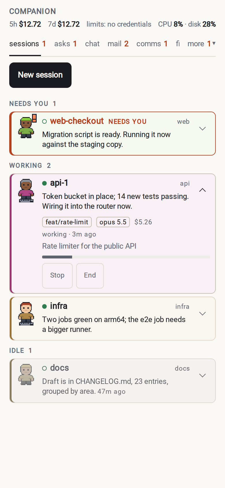
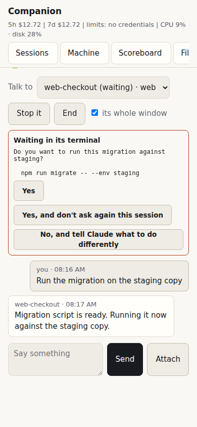
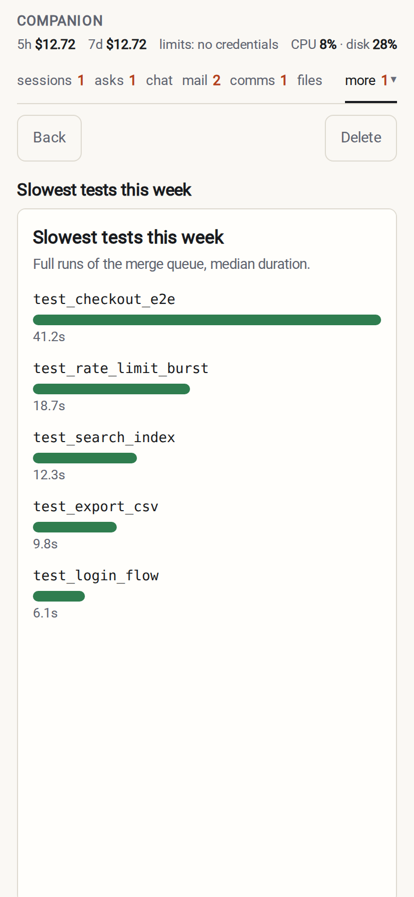
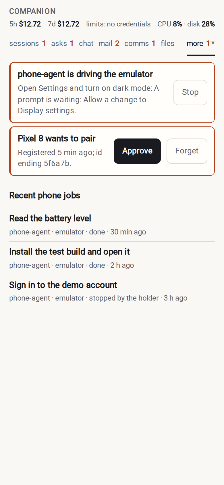
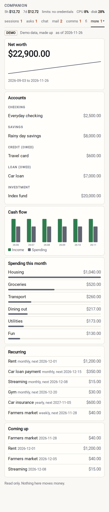
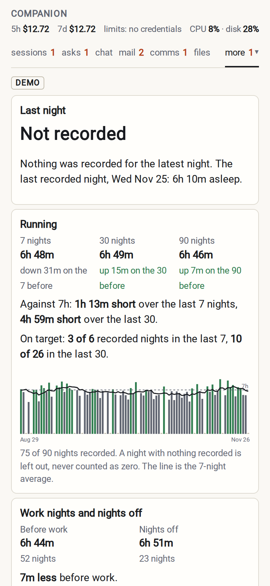
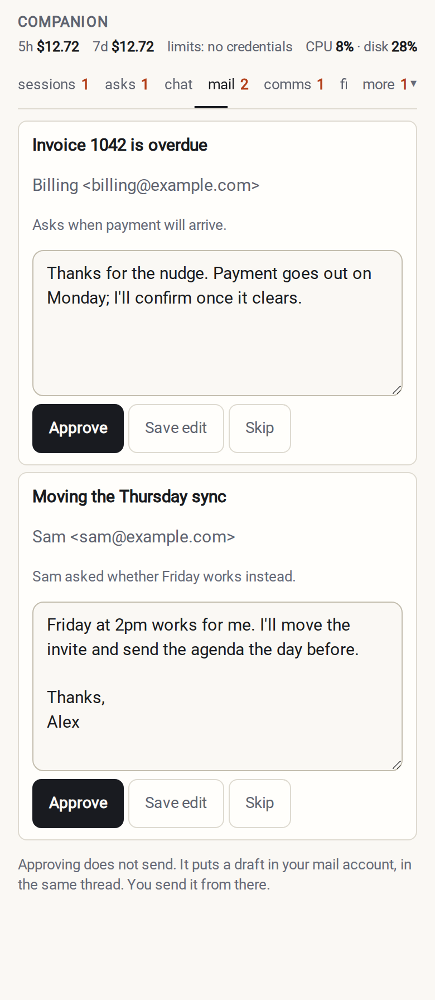
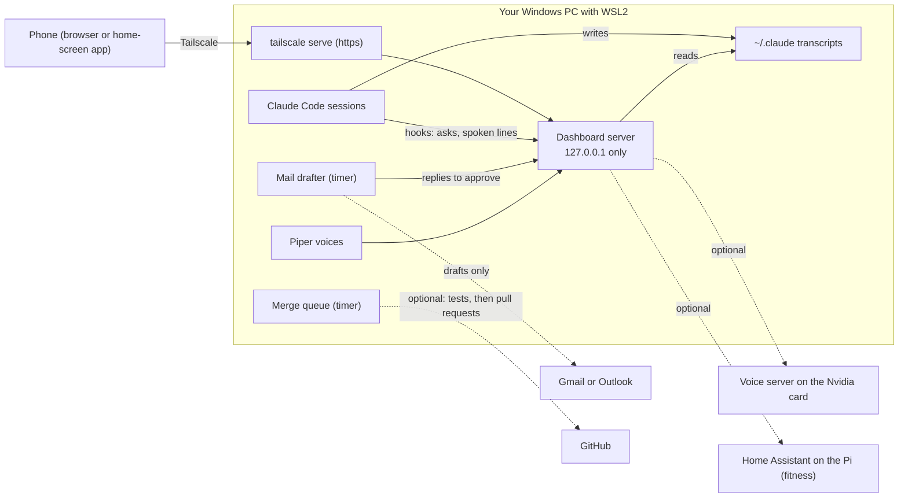

<h1 align="center">agent-companion</h1>

<p align="center">
  <b>A local, phone-first dashboard for people running several Claude Code sessions at once: see what is running, what it costs, and what needs a decision.</b>
</p>

<p align="center">
  
  
  
  
  <a href="https://github.com/trivgar/agent-companion/actions/workflows/tests.yml"></a>
</p>

agent-companion runs on your PC and puts the state of your Claude Code sessions
in one page, so you can answer asks and chat from a paired phone without
leaving the work at your terminal. Optional helpers add drafts, spoken replies,
a voice lab, collaboration notes, and an Android phone driver when you choose
to enable them.

It is not a cloud service: there is no agent-companion account, no server of
ours, and no telemetry. It runs on your PC and talks to your phone over your
own Tailscale. Most of its interaction with `~/.claude` is read-only, but
optional hooks and the local usage cache write there. Those writes, and every
outbound connection it can make, are listed below.

**Highlights**

- **Every session on one card list.** Model, cost, how full its context is, the branch, the last reply, and which one is waiting on you. Claude Code and Codex sessions both.
- **Answer from your phone.** Permission prompts and questions arrive with Allow and Deny; a terminal dialog no hook reported can be answered from the chat window.
- **Chat to any running session.** Your words go into its terminal pane, guarded and logged, with photos attached if you like.
- **Pages.** An agent publishes a self-contained HTML report, and it opens in a sandbox with no network and no access to the dashboard.
- **A merge queue for agents.** Branches land as pull requests only when the whole suite passes on the batch.
- **Local, no telemetry.** It runs on your PC, reaches your phone over your own Tailscale, and lists every file it writes and every connection it can make.

<p align="center">
  
  
  
  
</p>
<p align="center">
  
  
  
</p>
<p align="center"><sub>Phone width, 390 px. Every name and number is made up. More in <code>docs/images/</code>.</sub></p>

## New in 0.3

- **Phone driver** (off by default): an agent can drive an Android test emulator, or, after a second opt-in, Android's Accessibility switch, pairing and your approval, a real phone. Payments, sending, deleting and passwords stay your tap.
- **Pages**: agents publish sandboxed HTML pages to the dashboard with `bin/page publish`.
- **Terminal dialogs in Chat**: a numbered choice no hook reported is answered from the chat window.
- **Codex sessions** appear on the card list and in Chat beside Claude Code ones.
- **Model watch**: once a day, the model picker and price table are checked against Anthropic's published lineup, with one push per difference.
- **Faster cards**: the list never waits on a slow `git status`, and the first load reads usage on threads.
- **Chat sends you can trust**: a send confirms delivery, never types over words already in a session's box, and waits for a slow session. HEIC photos upload as JPEG with location removed.
- **Merge queue**: a flaky batch reruns only the tests that failed, records test durations, and can free memory before a run (`mergeq_make_room`, off by default).
- **Job reaper** (off by default) can also stop idle language servers under a live session.
- **New session** can start another program or model through configurable launchers.

## What you need

- **Windows 10 or 11 with WSL2 and Ubuntu.** It is built and tested only there.
- **Claude Code, installed and signed in inside WSL.** The dashboard reads the
  sessions Claude Code writes, so Claude Code has to work first.
- **Python 3.11 or newer.**
- Optional: Tailscale to open the page on your phone (without it, the page is
  on this PC only), tmux for Chat, New session and Restore, and an Nvidia card
  for the voice lab.

**Setting it up?** Hand [INSTALL.md](INSTALL.md) to your own Claude Code. It
separates the core path from optional services. To try it on made-up sessions
first, see [Just want to look?](#just-want-to-look)

For PC-specific safeguards that are intentionally not shipped here, see
[suggested features](docs/suggested-features.md).

## What it does

The tabs, in the order they sit on the page, then the pieces that work around
them. Turn any tab off with the `features` setting.

**Sessions.** One card per live Claude Code session: model, cost, how full its
context is, the git branch, and its last reply. A session that is waiting on
you says so. Set a context line to flag a top-level session that needs
`/clear` and receive one push notification on each crossing, which opens that
session. Background Bash jobs show their command and age. The server can also
stop stuck ones, **off until you set `job_reaper_every_min`**: then a
background shell whose Claude session has ended is terminated once it is an
hour old (`job_reaper_after_min`), and one under a live session only if you
set `job_reaper_max_hours`. That includes a dev server a session started in the
background and left running, so name those in `job_reaper_keep`.
Optionally, `job_reaper_idle` names language servers below a live session to
stop only after their whole process tree has used no CPU for
`job_reaper_idle_hours` (2 by default); they restart on their next use.
`python3 -m agent_companion.jobreaper --dry-run` lists what would go. Each
card has a deterministic procedural pixel sprite based on its display name. At the top, your 5-hour and 7-day spend, real
Claude limits, and, when local Codex rollout logs exist, Codex plan limits.
The branch on a session card refreshes after an agent changes its repository.
If Git is slow, the page keeps its last branch value and refreshes it in the
background rather than making the card list wait.

**Machine.** Local CPU use, load, memory, swap, configured disks, CPU temperature, GPU details when their command is available, and the five heaviest process command names. Missing readings explain why rather than reading as zero. Optional warning pushes are off by default.

**Scoreboard.** For commits the installed hook recorded in configured projects, shows each session's added lines, lines later reworked inside a configurable window, and optional good or bad owner marks. The marks are counts only and never alter rework.

**Restore**, on the Sessions tab. A small local snapshot records each
tmux-backed session every few minutes. After a reboot or crash, the Sessions
tab lists missing sessions and can resume them in their old tmux names and
folders.

**New session**, on the Sessions tab too. Start Claude in a folder listed in `[projects]` with an optional first message; the page sends a project's key, never a path, says who already works there, and keeps unavailable folders disabled. The command is typed into a new tmux pane's shell, and a start counts once a Claude process is seen in that pane.

**Files.** Browse every checkout like a repository view, its worktrees under
it as branches: folders, files, the folder's README, the last commit, images.
Open a file and save an edit. Files git ignores and generated folders
(`node_modules`, `venv` and the like) stay out of the view; binary files and
files over 1 MB open read only. A save commits only that file when it was clean
before the edit; it never pushes.

**Specs.** Read the design specs and plans in every checkout's `docs/superpowers/specs` and `docs/superpowers/plans`, plus any folder named in `spec_folders`, newest first, each document once per repository and with who is working in it, without permitting edits. A new spec sends a push notification to your phone; a new plan does not.

**Pages.** An agent can publish one self-contained HTML page to the dashboard with `bin/page publish FILE --title TITLE`. Pages run in an opaque-origin, no-network sandbox. They are private to the owner unless `--household` is used; `pages_private_dirs` keeps selected source folders owner-only. The Android app must be built from this version or later to open them.

**Asks.** When a session wants permission to run something, or asks you a
multiple-choice question, the asks hook sends it, with the full command or
tool input, to the dashboard on your PC, and it shows up here with Allow and
Deny. If the command was long and got shortened, the page makes you open the
full text before it lets you allow it. The session's own prompt shows at the
same time, and whichever you answer first wins; when the dashboard is not
running, the hook steps aside at once. Claude Code's default auto mode settles
most prompts itself, so only what it will not decide comes here; INSTALL.md
says how to send every one.

**Chat.** Type to any running session from your phone. Your words go into that
session's terminal pane, as if from the keyboard. When a terminal client draws
a numbered choice that its hooks did not report, Chat can show it and answer it
from that session's chat window. It answers only the same dialog while that
session remains in the foreground, and refuses terminal-only and multi-select
choices. Every send and terminal choice is guarded and logged.

**Phone driver (optional).** A dedicated agent can run one logged, serialized
job at a time through an Android accessibility service. It is off by default:
`phone_driver = true` enables the relay, Phone tab, `bin/phone` test-emulator
CLI, and `bin/phone_mcp.py` MCP server. That setting permits only the test
emulator. A real phone also needs `phone_driver_real_phone = true`, a
driver-enabled app build, Android's own Accessibility switch, pairing, and
approval in the Phone tab. Each job has a visible Stop control, and the device
holder can stop it from the banner, notification, or dashboard.

The driver holds payments and purchases, sending or posting as the holder,
deleting, installs and updates, security changes, and actions it cannot safely
classify for the holder's tap. A password, PIN, or code is the holder's turn to
type and never reaches the agent; verification codes are hidden, and a
screenshot is refused when it could expose a filled secret or code. Touching
the device or taking a call pauses the job until the holder taps Resume. On a
real phone, browser and unknown-app automation stays strict: browser swipes
are held except for vertical page scrolling, and unknown actions or typing are
held. After an Allow, the driver reads the target again and refuses if the
screen or target changed.

**Mail.** A helper reads new mail and writes replies in your voice for you to
approve. Approving makes a draft in your own mail account. You press send
yourself, because the code has no way to send. Gmail works through the Gmail
connector in claude.ai; Outlook is a one-file plug-in, with a guide in
[docs/mail-outlook.md](docs/mail-outlook.md).

**Money.** An outline of accounts, net worth, cash flow, spending by category
and recurring bills. It ships with a labelled DEMO household so you can see it
first. Real bank feeds (SimpleFIN, a CSV export or Plaid) come later, as one
file you have Claude write. See [docs/money-sources.md](docs/money-sources.md).
Read only; it cannot move money.

**Fitness.** Sleep, resting heart rate, steps, distance and weight over time.
Home Assistant is the optional source (it holds Fitbit, Garmin, Withings and
others); other sources plug in the same way, and a DEMO source is built in.
A night with no data is left out, never counted as zero. See
[docs/fitness-sources.md](docs/fitness-sources.md).

**Deferred.** A shared Markdown backlog for work parked until later, including cross-project handoffs that appear when the receiving project starts a session.

**Comms.** Your sessions talk. Each reply ends with one short line that is
spoken, rendered on your PC with Piper and played on your phone while the page
is open. Hold and volume are on the Settings page. See
[comms/README.md](comms/README.md).

**Voice lab.** Make a voice from clips of someone who has agreed to it, on your
Nvidia card (GPT-SoVITS, inside WSL2), then use it in comms. The tab shows
what you have built and plays its clips. With a speech coordinator of your own
in `tts_dir`, it also lets you audition a voice, keep or skip a build, set a
voice's tier and hear a test line. Training happens in the shell, not on the
page. See
[voicelab/README.md](voicelab/README.md).

**Connections.** One honest row per thing that could be wired up (hooks, Piper,
mail, Tailscale, voice server, and so on): ok, off, or broken, with one
sentence on how to fix it. Recheck re-runs the probes.

**Settings.** Shows what the app is running with and the line to change each
setting. The page itself changes the context line, comms (hold, volume, a test
clip), and removes a paired device. It never writes your config file.

**Push.** Notifications to your own phone when a session needs you, through the
browser's own Web Push, encrypted end to end. Add the page to your home screen
first (on iPhone this is required).

**Gzip.** Large dashboard pages, styles, scripts, JSON and plain-text responses use gzip when the browser supports it; downloads, media and live streams stay unchanged.

**Claude-to-Claude notes.** If two people's Claudes work on one repo, they leave
each other notes as GitHub issues, and code goes by pull request. Notes are
information, never orders. See [COLLAB.md](COLLAB.md).

**The merge queue.** Work lands as pull requests rather than as pushes to
main. A session queues its finished branch, and the queue merges the batch,
runs the whole suite once, then opens and merges a pull request for each
branch only when it is green. A collaborator's pull request goes through the
same queue with `mergeq add --pr <number>`. On red, it first checks main
itself, since nothing merges onto a red main, then tries each branch alone to
find the one to blame; the rest land once the whole suite passes on them
again. When no branch is red alone, only the tests that failed run again on
the batch, and it lands if they pass. If main moves outside the queue while it
lands, what is left waits for the next batch. Once a branch lands, its
worktree is removed if nothing in it is uncommitted. `mergeq_land = "local"`
fast-forwards the base branch in the checkout and pushes it instead. COLLAB.md
has the details.

Each full pytest run records its JUnit test durations and outcomes locally, so
`python3 -m agent_companion.testtimes --slow 25` can report recent slow tests.
With `mergeq_make_room = true` (off by default), a full run first makes a best
effort memory preflight. When memory is short, it can stop idle Gradle or
Kotlin daemons only when no Gradle client is running, and reap configured
orphaned workers. The preflight reports what it did and never prevents the
suite from running.

## How it fits together



## Local writes

Your Claude Code sessions and transcripts remain in `~/.claude`. By default,
agent-companion reads them. It writes the following there only when the
corresponding feature is used:

- The Sessions tab writes `~/.claude/usage-cache.json` and
  `~/.claude/limits-cache.json` unless `data_dir` is configured. They are local
  caches for token totals and limit checks.
- The stale background-job reaper writes `job-reaper.jsonl` in the app data
  directory when it terminates a stuck snapshot shell: an orphan, or with
  `job_reaper_max_hours` set, one under a live session past that age. It
  records the time, process ids, age, why and redacted command. The reaper
  runs only once `job_reaper_every_min` is set. With `job_reaper_idle`, it
  also keeps its small CPU-idle history in `job-reaper-idle.json` there for
  matching language servers below a live session.
- The standalone `notify` hook writes a waiting marker at
  `~/.claude/session-companion-waiting/<pid>`. If that hook sends Web Push, it
  uses the same push key and devices as the dashboard,
  `session-companion-vapid.json` and `session-companion-push.json` in
  `push_dir` (the app data directory unless you set it), and can create them
  there.
- The Files tab writes only a text file git lists in a checkout it shows
  (`checkout_dirs`, else `[projects]`).
  It writes beside the file and renames it, then commits only that file when it
  was clean before the save. It never pushes.
- The Scoreboard writes `scoreboard-cache.json` and `scoreboard-marks.json` in
  the app data directory. They hold local line-count cache entries and the
  owner's good or bad commit marks.
- When `health_push = true`, the Machine watcher writes `health-alerts.json`
  in the app data directory. It contains only warning crossing and delivery
  times, so each reading can be pushed at most once in six hours.
- `python -m agent_companion.server.install_hooks` adds its hooks to
  `~/.claude/settings.json` and first writes a timestamped
  `~/.claude/settings.json.bak-...` backup: the asks hooks (PermissionRequest,
  and PreToolUse on AskUserQuestion; what they send is under Asks above),
  SessionStart and UserPromptSubmit hooks for deferred handoffs, and a
  PostToolUse(Bash) hook
  that appends each `git commit` a session makes to `commits.jsonl` in the app
  data directory (session id, folder, commit and subject; nothing leaves the
  PC). Its `--uninstall` option removes only those hooks and also backs up the
  settings file when it changes it.
- `comms/install.sh` adds its Stop, SessionStart, and UserPromptSubmit hooks to
  `~/.claude/settings.json` and first writes a timestamped backup. It also
  registers the `tts` MCP server with `claude mcp add tts --scope user`; Claude
  Code keeps that user-scope registration in its own user configuration,
  normally `~/.claude.json` beside the `~/.claude` directory.
- `python -m agent_companion.collab install` is another optional hook setup.
  It adds its SessionStart hook to `~/.claude/settings.json` with a timestamped
  backup.
- `python3 -m agent_companion.restore snapshot` writes
  `restore-snapshot.json` in the app data directory. Its optional timer
  installer writes `agent-companion-restore-snapshot.service` and
  `agent-companion-restore-snapshot.timer` in the user systemd directory;
  snapshots are private local state and a recent multi-session snapshot is
  retained for up to four hours after every saved session disappears at once.
- With `tts_dir` naming a speech coordinator of your own, the comms routes
  change that coordinator's own settings files (`volume.conf`, `announce.conf`,
  its effects, mute and hold files), and the Voice lab's buttons write its
  `tiers.conf` and a `decision.json` in the audition or build folder they act
  on. Each file is written beside and renamed into place.
- The merge queue keeps its entries, its history and an integration worktree
  in `~/.local/share/agent-companion/mergeq` (or `AGENT_COMPANION_MERGEQ_DIR`).
  Full pytest runs also keep up to 60 compressed JUnit duration and outcome
  records in its `test-times` directory (or `AGENT_COMPANION_TEST_TIMES_DIR`).
  Once a branch lands it removes that branch's own worktree, only when nothing
  in it is uncommitted.
- The optional phone driver writes private, mode-restricted state under
  `~/.local/share/agent-companion/phone` (or `AGENT_COMPANION_PHONE_DIR`):
  registered-device metadata, the emulator lease, a local CLI capability cache,
  and one folder per job with its metadata and `actions.jsonl` audit log.
  Screen text and screenshots live beside that job. They are eligible for
  deletion seven days after it ends and are swept on a later job start or
  `phone sweep`; its metadata and audit log remain. The relay keeps only hashes
  of device secrets and job capabilities.
- `python3 -m agent_companion.modelwatch` writes its last reported model-lineup
  difference to `~/.local/state/agent-companion/modelwatch.json`, unless
  `AGENT_COMPANION_MODELWATCH_STATE` names another path.

The app's own asks, mail queue, clips, voices, paired-device hashes, and other
state live in `~/.local/share/agent-companion/` and
`~/.config/agent-companion/`. The phone keeps its owner key in browser local
storage.

## Outbound connections

No outbound service is required for the local dashboard. The first row below
happens whenever you are signed in to Claude Code, unless you turn it off; the
rest only when their feature is enabled or configured:

| Service | When it can be contacted |
|---|---|
| Anthropic usage endpoint | While the dashboard is open, at most once every five minutes, to show your real 5-hour and 7-day limit use. It reads your Claude Code login token from `~/.claude/.credentials.json` and sends it only to `api.anthropic.com`, the service that issued it. The token is never logged, stored or shown. With no login file, no call is made, and `claude_limits = false` turns it off. |
| Anthropic models overview | `python3 -m agent_companion.modelwatch`, or its optional daily user timer, reads Anthropic's public model-overview Markdown to compare the Chat model picker and price table. It has no account token and never changes either one. |
| GitHub | `gh` contacts GitHub for the optional merge queue and collaboration notes. The Comms installer also downloads the pinned Piper archive from GitHub. |
| Hugging Face | The Comms installer downloads the selected Piper voice files. |
| Gmail | The optional mail drafter runs Claude Code with the Gmail connector after mail is configured, or, for an account set to `source = "imap"`, talks to Gmail's IMAP server itself with the app password in that account's `credentials_file`. |
| Outlook | Only an Outlook plug-in that you add and configure can contact Microsoft services. |
| Home Assistant | The fitness source contacts the configured Home Assistant URL. |
| Browser Web Push | A subscribed browser's push endpoint is contacted when Web Push is enabled. |
| Phone driver relay | An enabled Android driver registers with, polls, and reports to the configured agent-companion dashboard address. A started job may wake it through FCM; the wakeup contains only the job id. |
| Firebase Cloud Messaging | The optional Android delivery path and phone-driver wakeups contact FCM only with `fcm_service_account_file` configured and a registered device. |
| Voice server | Comms contacts the configured custom voice server only for a `server:<name>` voice. With `tts_dir` naming a coordinator that lists hosts in its `remote-hosts.conf`, the dashboard asks each host serving a voice in use for its `/health`. |
| Gemini Live | The Live Call button and routes are enabled only when `gemini_key_file` is set. The browser sends microphone audio and selected session text to Google for that call. |

## Safety, in short

The full list, with the reasons, is in [CLAUDE.md](CLAUDE.md).

- **Mail never sends.** There is no send, reply or forward code, and a test fails if one appears.
- **Writes need a paired device.** An approval needs your phone's key, a JSON request and the page's own address, all three. The token the permission hook uses can approve nothing.
- **Loopback only.** The server listens on `127.0.0.1`, the `server_bind` default; leave it there. Your phone reaches it through `tailscale serve`, so the port is never opened to the network.
- **The phone driver is a separate opt-in.** The real-device gate, Android Accessibility switch, device pairing and approval, dedicated phone-agent key, visible Stop controls, and on-device holds all apply before it can act. They do not make it safe to use a driver-enabled app on a device you do not control.
- **Nothing personal in the repo.** Examples use made-up names, and a test scans for real-looking addresses, tailnet names and keys.
- **Voices need consent.** Only stock Piper voices ship. A custom voice is for someone who has agreed.
- **The honest limit.** A session running in bypass-permissions mode on your account can do anything you can, including reading the hook token or pairing itself. The walls stop a session that is waiting on a prompt from approving itself through this server. Where asks matter, do not run sessions in bypass mode.

## Getting started

1. Follow [INSTALL.md](INSTALL.md) on Windows with WSL2 and Ubuntu.
2. Install the server and pair a browser before enabling extras.
3. Add Tailscale, hooks, mail, comms, or other optional pieces one at a time.

### Just want to look?

This shows four made-up sessions in this PC's browser, not your own. It needs
WSL2 with Ubuntu, Git, and Python 3.11 or newer with `python3-venv`
(INSTALL.md steps 1 and 2):

```bash
git clone https://github.com/trivgar/agent-companion.git
cd agent-companion
python3 -m venv .venv
.venv/bin/python -m pip install -e '.[app,push]'
.venv/bin/python examples/demo_home.py /tmp/demo
AGENT_COMPANION_CLAUDE_HOME=/tmp/demo/.claude .venv/bin/python -m agent_companion.server
```

In a second terminal in the same folder,
`.venv/bin/python -m agent_companion.server pair --name browser` prints a
one-time link. Open it, and the page shows the made-up sessions.
`AGENT_COMPANION_CLAUDE_HOME` is what points the server at the demo.

`demo_home.py` starts one `sleep` per made-up session so they count as live;
they end on their own after an hour. Even a look creates the app's own
folders, as an install does (`~/.config/agent-companion` and
`~/.local/share/agent-companion`); [Uninstall](#uninstall) removes them.

## Status

Version 0.3. The dashboard has 17 tabs by default. Enabling the optional
phone driver adds an 18th tab.

The automated suite covers the dependency-free library, server routes,
phone-width pages, hooks, mail against a fake source, comms against a fake
Piper, the merge queue against throwaway repositories, model watch, terminal
dialogs, the phone-driver relay and CLI/MCP gates, Android driver source
guards, and the leak scan. Run it with `python3 -m pytest -q`.

GitHub runs the whole suite on Python 3.11 and 3.13 for pull requests, pushes
to `main`, and every Monday, using the dependency versions pip resolves at
that time. Found a bug? Open an issue on GitHub. For security reports, see
[SECURITY.md](SECURITY.md); [CONTRIBUTING.md](CONTRIBUTING.md) explains how to
send a change.

## For developers: the library

The dashboard sits on a small library with no dependencies. It works alone,
without the server. If you are changing the code, read [CLAUDE.md](CLAUDE.md)
first: it is the project guide your own Claude Code reads, with the rules a
change must keep. [COLLAB.md](COLLAB.md) is how two people's Claudes share one
repo, and [CHANGES.md](CHANGES.md) lists what changed, newest first.

### Quick start


```bash
git clone https://github.com/trivgar/agent-companion
cd agent-companion
python3 -m venv .venv && . .venv/bin/activate
python3 -m pip install -e .

python3 examples/sessions.py                     # your own sessions
```

No sessions running, or want to look first? Build a made-up `~/.claude`:

```bash
python3 examples/demo_home.py /tmp/demo           # four fake sessions
python3 examples/sessions.py --home /tmp/demo/.claude
```

Python 3.11 or newer. The commands below assume that virtual environment is
active (Ubuntu refuses `pip install` outside one). For Web Push:
`python3 -m pip install -e '.[push]'`.

### What it reads

| Source | What comes out |
|---|---|
| `~/.claude/sessions/*.json` | Live sessions: pid, project, name, who started it (you, another session, a background job) |
| `~/.claude/projects/**/*.jsonl` | Each session's model, tokens, cost, context fill, last prompt and reply, its helper agents and workflows |
| `/proc` | Which of those processes are really alive (the registry keeps dead ones) |
| `git` in each session's repo | Branch, ahead/behind, uncommitted files. Read only: it never takes `index.lock` |
| Anthropic's usage endpoint | Your real 5-hour and 7-day limit use, asked with your Claude Code login token (see [Outbound connections](#outbound-connections)) |

Transcripts are read incrementally by byte offset, so a 75 MB transcript costs
a few kilobytes per poll.

### Use it in code

```python
from pathlib import Path
from agent_companion.reader import SessionReader
from agent_companion.usage import UsageIndex

home = Path.home() / ".claude"

for s in SessionReader(home).snapshot():
    print(s["project"], s["status"], s["model"], f'${s["cost_usd"]:.2f}', f'{s["context_pct"]}% context')

usage = UsageIndex(home)
usage.refresh()            # reads only what is new since the last call
print(usage.snapshot())    # tokens and cost in the 5-hour and 7-day windows
```

Each session row also carries `waiting` (blocked on a question or a
permission), `last_reply`, `subagents`, `parent_pid` and `job` (for helpers and
background runs), and `tokens` by type.

| Module | What it does |
|---|---|
| `registry` | The live session registry, with dead entries dropped |
| `reader` | One row per session, everything above joined up |
| `transcript` | The incremental transcript reader |
| `usage`, `pricing` | Tokens and cost over the 5-hour, 7-day and lifetime windows; prices per model from Anthropic's published rates |
| `limits` | Real limit use from Anthropic's OAuth usage endpoint |
| `activity`, `tasks` | What an agent has been doing: tool calls, time spent, workflows and helpers |
| `gitstate`, `gitlive`, `changes` | Each repo's branch, ahead/behind, and unpushed work; session cards keep their last Git state while a changed repository refreshes |
| `messages` | Messages sessions send each other (SendMessage) |
| `notify` | A permission and question hook that marks the session waiting and speaks or pushes one line |
| `dialogs` | Numbered terminal dialogs that have no hook-backed ask, read and answered conservatively from Chat |
| `webpush` | Web Push to your own devices, VAPID keys kept locally |
| `checkouts`, `files`, `specs` | The checkouts Files and Specs show, grouped by repository; reading and saving a checkout's files; the specs and plans in them |
| `clearline` | The context line: which top-level sessions are past it, and one push per crossing |
| `jobreaper` | Stops stuck background snapshot shells; `python3 -m agent_companion.jobreaper --dry-run` lists them |
| `mergeq`, `testtimes`, `memclear` | The merge queue engine (`Merger`), its full-run duration records, and its optional best-effort memory preflight |
| `phone` | The optional Android phone-driver relay, test-emulator helper, one-command job protocol, and local audit trail |
| `modelwatch` | Checks the configured Chat picker and exact price rows against Anthropic's public model overview without changing either |

An unknown model is counted as **unpriced**, never as free: the lifetime
figure says how many tokens it could not price.

### The permission hook

`notify` turns Claude Code's `PermissionRequest` hook into one short line,
"A session needs your OK on this: Bash, npm test", so a blocked session does not sit
there looking idle. Add it to `~/.claude/settings.json`:

```json
{
  "hooks": {
    "PermissionRequest": [
      {"matcher": ".*", "hooks": [{"type": "command", "command": "python3 -m agent_companion.notify", "timeout": 2}]}
    ]
  }
}
```

It never blocks and never fails the session: every error path exits 0. Speech
is optional. By default it uses the bundled `comms/speak.sh` coordinator. Set
`tts_dir` to an AgentVibes-compatible directory containing an executable
`speak.sh` to override it; push is optional too, with the `push` extra installed
and a device subscribed.

### Library settings

In `~/.config/agent-companion/config.toml`, or as `AGENT_COMPANION_<KEY>`
in the environment, which wins. A file as well as the environment, because
hooks run outside any server's process. The server's own settings
(`server_port`, `features`, fitness and more) are in `config.example.toml`.

| Key | What it does |
|---|---|
| `name` | What spoken lines call you. Blank leaves the address out. |
| `sprite_overrides` | A table mapping a session display name to `#rrggbb`, to pin that session's sprite hue. |
| `url` | The address a push opens. Web Push needs https, e.g. a `tailscale serve` URL. Default `http://127.0.0.1:8770` |
| `contact` | `mailto:` address push services can reach you at |
| `phone_driver` | Make the optional phone-driver relay, `bin/phone`, and `bin/phone_mcp.py` available; it adds the Phone tab unless `features` excludes it. Default false. It permits the test emulator, not a real phone. |
| `phone_driver_real_phone` | Permit a physical Android device to register or receive a job after the first phone-driver gate; default false. It still needs a driver-enabled build, Android Accessibility enabled, pairing, approval, and the phone agent's key. |
| `phone_driver_agent` | Name assigned to phone-driver jobs when no CLI holder is supplied; default `phone-agent`. |
| `phone_android_sdk` | Android SDK location for the test-emulator helper; default `~/android-sdk` (or `ANDROID_HOME` when set). |
| `phone_android_package` | Package the emulator helper installs and addresses; default `com.agentcompanion.app`. |
| `phone_agent_key_file` | Real-phone key file read by `bin/phone_mcp.py`; default `~/.config/agent-companion/phone-agent.key`. For a nondefault relay key, set `AGENT_COMPANION_PHONE_AGENT_KEY` too. |
| `push_dir` | Where the push key and the subscribed devices live, for every push sent or subscribed; default `<data_dir>`. Moving it mints a new key, and every device subscribed before must subscribe again |
| `pages_private_dirs` | Folders whose published pages may never use `--household` (a list; `:`-separated in the environment) |
| `icons` | A module with `icon_data(tag, title)` and `icon_for(tag, title)` for each push's picture (optional) |
| `archive_roots` | Old transcript trees to count in the lifetime total (a list; `:`-separated in the environment) |
| `codex_home` | Codex home to read local rollout logs from; default `~/.codex`, and absent logs keep the Codex strip off |
| `claude_limits` | Ask Anthropic for your real 5-hour and 7-day limit use with your Claude Code login token; default true, and false never reads the token or makes the call |
| `clear_line` | Context tokens at which a top-level session says it needs `/clear`; default 400000 |
| `clear_over_file` | Where the clear line writes who is past it, for a prompt hook to read; default `<data_dir>/needs-clear.json` |
| `tts_dir` | Directory containing an executable speech coordinator `speak.sh`; optional and compatible with AgentVibes-style coordinators |
| `[voice_host_names.<host>]` | How the voices status line names a host whose bare name reads wrong: `subject`, `possessive` and `place`, such as "the voice host on this PC", "this PC's" and "this PC" |
| `voicelab_running_minutes` | Voice lab: a part-done build that moved within this many minutes shows as running; default 15 |
| `voicelab_baseline_tags` | Voice lab: the tags a build's `scores.json` gives the live voice's own takes, its baseline (a list; `:`-separated in the environment); default `["live"]` |
| `job_reaper_after_min` | Age before an orphaned background snapshot shell is terminated; default 60 |
| `job_reaper_every_min` | Reaper interval in minutes; default 0, which leaves the reaper off. Set it (10 is a good start) to turn it on |
| `job_reaper_max_hours` | Hours past which a background job under a live session is reaped too; unset or 0 leaves those alone |
| `job_reaper_keep` | A regular expression (any case) for commands never reaped, such as dev servers and log follows; one that cannot compile stops the reaper |
| `job_reaper_idle` | A regular expression (any case) for language servers under a live session to reap only after their process tree is CPU-idle; unset leaves this rule off |
| `job_reaper_idle_hours` | Positive CPU-idle hours before a matching language server is reaped; default 2 |
| `health_disks` | Extra local disk paths for the Machine tab; `/` is always included |
| `health_hot_c` | CPU and GPU warning temperature in C; default 85 |
| `health_disk_full_pct` | Disk-use warning percentage; default 90 |
| `health_mem_full_pct` | Memory-use warning percentage; default 92 |
| `health_push` | Send optional local Machine warning pushes; default false |
| `data_dir` | Directory for app state, including restore snapshots; default `~/.local/share/agent-companion` |
| `mergeq_land` | How the merge queue lands a green batch: `pr` (a pull request per branch, merged once its required checks pass) or `local` (the base branch fast-forwarded in the checkout and pushed); default `pr` |
| `mergeq_base` | The branch the merge queue lands on; default `main` |
| `mergeq_make_room` | Before a full merge-queue suite, run the optional best-effort memory preflight; default false. It does not run for a selected-test rerun. |
| `score_window_days` | Days after a recorded commit in which replacing one of its added lines counts as rework; default 7 |
| `restore_snapshot_interval_min` | Snapshot timer cadence in minutes, 1 through 60; default 5 |
| `systemd_user_dir` | Where the restore timer installer writes user units; default `~/.config/systemd/user` |
| `restore_python` | Python executable the restore timer runs; default is the Python that installed it |
| `[projects]` | Project name to folder. New session starts Claude only in these, and without `checkout_dirs` Files and Specs show these. A `[[projects]]` row (`name`, `path`) may add New session's `key` (what the page sends), `label` and tmux `prefix`; they default to the name. |
| `checkout_dirs` | Folders whose child folders are the checkouts Files and Specs show, such as `["~/work", "~/work/worktrees"]`; a listed folder is never itself one. Leave it out and the `[projects]` folders are the checkouts. In the environment, separate them with `:` |
| `checkout_skip` | Checkout folder names never shown or read, such as a stale clone |
| `checkout_prefer` | Worktree names that head their repository when its main checkout is skipped |
| `spec_folders` | More folders of design documents for Specs, by name, such as `{notes = "~/notes/docs"}`; listed as kind `docs`, and a session in a folder's parent counts as working on it |
| `specs_seen_file` | Where the spec push remembers what it announced; default `<data_dir>/specs-seen.json` |
| `files_author_name`, `files_author_email` | Who a Files save commits as (a repository's own `user.email` wins); default git's own identity |
| `files_log` | One line per Files save; default `<data_dir>/files.jsonl` |
| `[new_session]` | New session's `default_model`, `claude_args`: words every start passes to claude, such as a permission mode, and `launchers`: other programs and models the sheet offers (an older `projects` list here is still read) |

### Helpers and background jobs

Each session row says who started it. `parent_pid` is the nearest live
session above it in the process tree (a helper a session ran), `root_pid` the
top of that chain, and `child` is true for both. A background run started
detached (`setsid`, a timer) has no session above it, so it says so in its
own environment instead:

| Variable | Row field |
|---|---|
| `AGENT_COMPANION_JOB=<word>` | `job`, and `child` is true |
| `AGENT_COMPANION_ABOUT=<name>` | `job_about`: whose work the job is about |
| `CLAUDE_TTS_SILENT=1` alone | `job` reads `headless` |

Only those names are read from `/proc/<pid>/environ`, once per process, and
only for a session with no session above it. Nothing else in the environment
is kept.

Each item in `subagents` (an Agent-tool helper that wrote in the last 90 s)
carries `label` (its first prompt line, cut to a chip), `ago`, `status`
(`busy` when it wrote in the last 30 s), `cost_usd` and `started_at`.

`python3 -m agent_companion.modelwatch` compares the Chat model picker and the
exact model ids in the price table with Anthropic's public models overview. A
host can choose where a difference goes through its `file_fn` hook. The command
default is one Web Push to subscribed owner devices, once for each distinct
difference. It never edits the picker or pricing itself. The supplied
`agent-companion-modelwatch.timer`, if installed, runs it daily.

### Privacy

The local dashboard works without an external service. See
[Outbound connections](#outbound-connections) for the services it can
contact. A folder can be marked private (`SessionReader(home, hide=...)`): its
sessions are never listed or read, and can show as presence only ("someone's
agent, working").

### Tests

```bash
python3 -m pip install -e '.[app,push,test]'
python3 -m playwright install chromium
python3 -m pytest -q -rs
```

The suite runs in a temporary home of its own, so no test reads your
`~/.claude` or your settings. It still finds the browsers Playwright
installed, and the leak scan's private deny list if you keep one
(`~/.config/agent-companion/leak-terms`, or `AGENT_COMPANION_LEAK_TERMS`);
without that list only the generic patterns run. Without the
`playwright install` step the page tests skip rather than fail; `-rs` lists
every skip, so a short run says why.

## Uninstall

Run these commands from the repository root to remove the optional Claude Code
integrations without changing unrelated hooks:

```bash
# Asks and commit hooks installed by install_hooks.py
.venv/bin/python -m agent_companion.server.install_hooks --uninstall

# Comms hooks and its user-scope tts MCP registration
comms/install.sh --uninstall

# Collaboration notes SessionStart hook, if installed
.venv/bin/python -m agent_companion.collab uninstall

# Restore snapshot user timer
.venv/bin/python -m agent_companion.restore uninstall-timer
```

Each command leaves existing timestamped `settings.json` backups in place for
review. If you manually added the standalone `notify` hook, remove only its
`python3 -m agent_companion.notify` entry from the `PermissionRequest` hooks
in `~/.claude/settings.json`.

To remove agent-companion completely, also stop the services you enabled, stop
serving the page to your tailnet, and delete its folders:

```bash
systemctl --user disable --now agent-companion                # the dashboard service, if you set it up
systemctl --user disable --now mail-draft.timer               # if you set up mail drafting
systemctl --user disable --now agent-companion-mergeq.timer   # if you set up the merge queue
systemctl --user disable --now agent-companion-modelwatch.timer # if you set up model watch
rm -f ~/.config/systemd/user/agent-companion.service \
  ~/.config/systemd/user/mail-draft.{service,timer} \
  ~/.config/systemd/user/agent-companion-mergeq.{service,timer} \
  ~/.config/systemd/user/agent-companion-modelwatch.{service,timer}
systemctl --user daemon-reload

tailscale serve --bg 8770 off      # the command that turned it on, with off

rm -rf ~/.config/agent-companion ~/.local/share/agent-companion
rm -f ~/.local/state/agent-companion/modelwatch.json
rm -f ~/.claude/usage-cache.json ~/.claude/limits-cache.json
rm -rf ~/.claude/session-companion-waiting                    # if you added the notify hook
```

The two folders hold your settings, keys, paired devices, asks, mail queue,
voices, Piper, phone-driver audit data, and merge-queue test times; if you set
`data_dir`, delete that folder too. The
`~/.claude` lines remove the usage caches the Sessions tab keeps there and the
notify hook's markers. Delete a custom `AGENT_COMPANION_MODELWATCH_STATE` or
`AGENT_COMPANION_TEST_TIMES_DIR` too, if you set one. Then delete the clone,
which holds the `.venv`, and the
voice lab's GPT-SoVITS clone and conda environment if you made them. The system
settings INSTALL.md step 1 changed (systemd in `/etc/wsl.conf`, lingering, a
Windows sign-in task) are yours to keep or undo. On a phone, remove the
home-screen icon or the Android app, and clear the site's data, which holds its
owner key. If you enabled the phone driver, first turn off its Accessibility
service in Android Settings, then uninstall the driver-capable app. For the
test emulator, run `bin/phone emu stop` while `phone_driver` is still enabled;
then delete its `agent-companion-test` Android Virtual Device or uninstall its
app with `adb -s emulator-5580 uninstall <your phone_android_package>`.

## License

MIT. See `LICENSE`.
