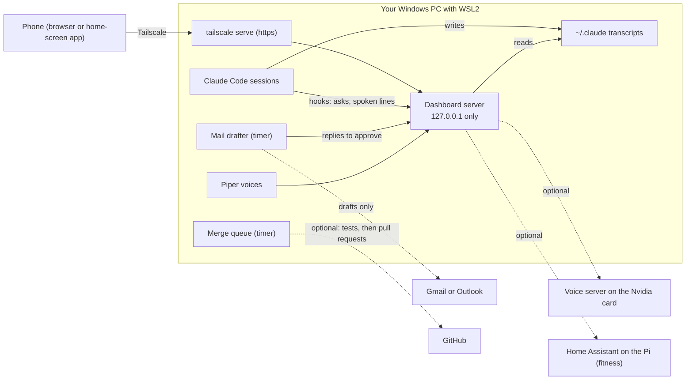

<h1 align="center">agent-companion</h1>

<p align="center">
  <b>A phone-first dashboard for your Claude Code sessions, and a few helpers that run on your own PC.</b><br>
  See which sessions are running, what they cost, which one is waiting on you, and answer from your pocket.
</p>

<p align="center">
  
  
  
  
</p>

Run four or five Claude Code sessions at once and the questions pile up. Which
one is stuck on a permission prompt? Which one is nearly out of context? What
did today cost? agent-companion answers them on one page you can open on your
phone. Around that page sit a few helpers that run on your own computer: a
mail drafter, spoken replies, a place to make voices, and notes between two
people's Claudes.

It is not a cloud service. There is no account, no server of ours, and no
telemetry. It runs on your PC and talks to your phone over your own Tailscale.
Most of its interaction with `~/.claude` is read-only, but optional hooks and
the local usage cache write there. Those writes, and every optional outbound
connection, are listed below.

<p align="center">
  
  
  
  
</p>
<p align="center"><sub>Phone width, 390 px. Every name and number is made up. More in <code>docs/images/</code>.</sub></p>

**Setting it up?** Hand [INSTALL.md](INSTALL.md) to your own Claude Code. It is
written for Windows with WSL2 and Ubuntu, and separates the core path from
optional services.

For PC-specific safeguards that are intentionally not shipped here, see
[suggested features](docs/suggested-features.md).

## What it does

The tabs, in the order they sit on the page, then the pieces that work around
them. Turn any tab off with the `features` setting.

**Sessions.** One card per live Claude Code session: model, cost, how full its
context is, the git branch, and its last reply. A session that is waiting on
you says so. Set a context line to flag a top-level session that needs
`/clear` and receive one push notification on each crossing, which opens that
session. Background Bash jobs show their command and age. Stuck ones are
stopped: an orphan after a configurable delay, and one under a live session
too once you set an age for that;
`python3 -m agent_companion.jobreaper --dry-run` lists what would go. Each
card has a deterministic procedural pixel sprite based on its display name. At the top, your 5-hour and 7-day spend, real
Claude limits, and, when local Codex rollout logs exist, Codex plan limits.

**Machine.** Local CPU use, load, memory, swap, configured disks, CPU temperature, GPU details when their command is available, and the five heaviest process command names. Missing readings explain why rather than reading as zero. Optional warning pushes are off by default.

**Scoreboard.** For commits the installed hook recorded in configured projects, shows each session's added lines, lines later reworked inside a configurable window, and optional good or bad owner marks. The marks are counts only and never alter rework.

**Restore**, on the Sessions tab. A small local snapshot records each
tmux-backed session every few minutes. After a reboot or crash, the Sessions
tab lists missing sessions and can resume them in their old tmux names and
folders.

**New session**, on the Sessions tab too. Start Claude in a folder listed in `[projects]` with an optional first message; the page sends a project's key, never a path, says who already works there, and keeps unavailable folders disabled. The command is typed into a new tmux pane's shell, and a start counts once a Claude process is seen in that pane.

**Files.** Browse every checkout like a repository view, its worktrees under
it as branches: folders, files, the folder's README, the last commit, images.
Open a file and save an edit. Files git ignores and generated folders
(`node_modules`, `venv` and the like) stay out of the view; binary files and
files over 1 MB open read only. A save commits only that file when it was clean
before the edit; it never pushes.

**Specs.** Read the design specs and plans in every checkout's `docs/superpowers/specs` and `docs/superpowers/plans`, plus any folder named in `spec_folders`, newest first, each document once per repository and with who is working in it, without permitting edits. Each new spec is pushed once.

**Asks.** When a session wants permission to run something, or asks you a
multiple-choice question, it shows up here with Allow and Deny. If the command
was long and got shortened, the page makes you open the full text before it
lets you allow it. Ignore it and the session's own prompt still appears.
Claude Code's default auto mode settles most prompts itself, so only what it
will not decide comes here; INSTALL.md says how to send every one.

**Chat.** Type to any running session from your phone. Your words go into that
session's terminal pane, as if from the keyboard. Every send is guarded and
logged.

**Mail.** A helper reads new mail and writes replies in your voice for you to
approve. Approving makes a draft in your own mail account. You press send
yourself, because the code has no way to send. Gmail works through the Gmail
connector in claude.ai; Outlook is a one-file plug-in, with a guide in
[docs/mail-outlook.md](docs/mail-outlook.md).

**Money.** An outline of accounts, net worth, cash flow, spending by category
and recurring bills. It ships with a labelled DEMO household so you can see it
first. Real bank feeds (SimpleFIN, a CSV export or Plaid) come later, as one
file you have Claude write. See [docs/money-sources.md](docs/money-sources.md).
Read only; it cannot move money.

**Fitness.** Sleep, resting heart rate, steps, distance and weight over time.
Home Assistant is the optional source (it holds Fitbit, Garmin, Withings and
others); other sources plug in the same way, and a DEMO source is built in.
A night with no data is left out, never counted as zero. See
[docs/fitness-sources.md](docs/fitness-sources.md).

**Deferred.** A shared Markdown backlog for work parked until later, including cross-project handoffs that appear when the receiving project starts a session.

**Comms.** Your sessions talk. Each reply ends with one short line that is
spoken, rendered on your PC with Piper and played on your phone while the page
is open. Hold and volume are on the Settings page. See
[comms/README.md](comms/README.md).

**Voice lab.** Make a voice from clips of someone who has agreed to it, on your
Nvidia card (GPT-SoVITS, inside WSL2), then use it in comms. The tab shows
what you have built and plays its clips. With a speech coordinator of your own
in `tts_dir`, it also lets you audition a voice, keep or skip a build, set a
voice's tier and hear a test line. Training happens in the shell, not on the
page. See
[voicelab/README.md](voicelab/README.md).

**Connections.** One honest row per thing that could be wired up (hooks, Piper,
mail, Tailscale, voice server, and so on): ok, off, or broken, with one
sentence on how to fix it. Recheck re-runs the probes.

**Settings.** Shows what the app is running with and the line to change each
setting. The page itself changes the context line, comms (hold, volume, a test
clip), and removes a paired device. It never writes your config file.

**Push.** Notifications to your own phone when a session needs you, through the
browser's own Web Push, encrypted end to end. Add the page to your home screen
first (on iPhone this is required).

**Gzip.** Large dashboard pages, styles, scripts, JSON and plain-text responses use gzip when the browser supports it; downloads, media and live streams stay unchanged.

**Claude-to-Claude notes.** If two people's Claudes work on one repo, they leave
each other notes as GitHub issues, and code goes by pull request. Notes are
information, never orders. See [COLLAB.md](COLLAB.md).

**The merge queue.** Work lands as pull requests rather than as pushes to
main. A session queues its finished branch, and the queue merges the batch,
runs the whole suite once, then opens and merges a pull request for each
branch only when it is green. A collaborator's pull request goes through the
same queue with `mergeq add --pr <number>`. On red, it first checks main
itself, since nothing merges onto a red main, then tries each branch alone to
find the one to blame; the rest land once the whole suite passes on them
again. If main moves outside the queue while it lands, what is left waits for
the next batch. Once a branch lands, its worktree is removed if nothing in it
is uncommitted. `mergeq_land = "local"` fast-forwards the base branch in the
checkout and pushes it instead. COLLAB.md has the details.

## How it fits together



## Local writes

Your Claude Code sessions and transcripts remain in `~/.claude`. By default,
agent-companion reads them. It writes the following there only when the
corresponding feature is used:

- The Sessions tab writes `~/.claude/usage-cache.json` and
  `~/.claude/limits-cache.json` unless `data_dir` is configured. They are local
  caches for token totals and limit checks.
- The stale background-job reaper writes `job-reaper.jsonl` in the app data
  directory when it terminates a stuck snapshot shell: an orphan, or with
  `job_reaper_max_hours` set, one under a live session past that age. It
  records the time, process ids, age, why and redacted command; set
  `job_reaper_every_min = 0` to turn that reaper off.
- The standalone `notify` hook writes a waiting marker at
  `~/.claude/session-companion-waiting/<pid>`. If that hook sends Web Push, it
  uses the same push key and devices as the dashboard,
  `session-companion-vapid.json` and `session-companion-push.json` in
  `push_dir` (the app data directory unless you set it), and can create them
  there.
- The Files tab writes only a text file git lists in a checkout it shows
  (`checkout_dirs`, else `[projects]`).
  It writes beside the file and renames it, then commits only that file when it
  was clean before the save. It never pushes.
- The Scoreboard writes `scoreboard-cache.json` and `scoreboard-marks.json` in
  the app data directory. They hold local line-count cache entries and the
  owner's good or bad commit marks.
- When `health_push = true`, the Machine watcher writes `health-alerts.json`
  in the app data directory. It contains only warning crossing and delivery
  times, so each reading can be pushed at most once in six hours.
- `python -m agent_companion.server.install_hooks` adds its hooks to
  `~/.claude/settings.json` and first writes a timestamped
  `~/.claude/settings.json.bak-...` backup: the asks hooks, SessionStart and
  UserPromptSubmit hooks for deferred handoffs, and a PostToolUse(Bash) hook
  that appends each `git commit` a session makes to `commits.jsonl` in the app
  data directory (session id, folder, commit and subject; nothing leaves the
  PC). Its `--uninstall` option removes only those hooks and also backs up the
  settings file when it changes it.
- `comms/install.sh` adds its Stop, SessionStart, and UserPromptSubmit hooks to
  `~/.claude/settings.json` and first writes a timestamped backup. It also
  registers the `tts` MCP server with `claude mcp add tts --scope user`; Claude
  Code keeps that user-scope registration in its own user configuration,
  normally `~/.claude.json` beside the `~/.claude` directory.
- `python -m agent_companion.collab install` is another optional hook setup.
  It adds its SessionStart hook to `~/.claude/settings.json` with a timestamped
  backup.
- `python3 -m agent_companion.restore snapshot` writes
  `restore-snapshot.json` in the app data directory. Its optional timer
  installer writes `agent-companion-restore-snapshot.service` and
  `agent-companion-restore-snapshot.timer` in the user systemd directory;
  snapshots are private local state and a recent multi-session snapshot is
  retained for up to four hours after every saved session disappears at once.
- With `tts_dir` naming a speech coordinator of your own, the comms routes
  change that coordinator's own settings files (`volume.conf`, `announce.conf`,
  its effects, mute and hold files), and the Voice lab's buttons write its
  `tiers.conf` and a `decision.json` in the audition or build folder they act
  on. Each file is written beside and renamed into place.
- The merge queue keeps its entries, its history and an integration worktree
  in `~/.local/share/agent-companion/mergeq` (or `AGENT_COMPANION_MERGEQ_DIR`).
  Once a branch lands it removes that branch's own worktree, only when nothing
  in it is uncommitted.

The app's own asks, mail queue, clips, voices, paired-device hashes, and other
state live in `~/.local/share/agent-companion/` and
`~/.config/agent-companion/`. The phone keeps its owner key in browser local
storage.

## Outbound connections

No outbound service is required for the local dashboard. These connections are
made only when their matching feature is enabled or configured:

| Service | When it can be contacted |
|---|---|
| Anthropic usage endpoint | When the dashboard refreshes real Claude Code usage limits and a local Claude Code login can supply the needed token. |
| GitHub | `gh` contacts GitHub for the optional merge queue and collaboration notes. The Comms installer also downloads the pinned Piper archive from GitHub. |
| Hugging Face | The Comms installer downloads the selected Piper voice files. |
| Gmail | The optional mail drafter runs Claude Code with the Gmail connector after mail is configured, or, for an account set to `source = "imap"`, talks to Gmail's IMAP server itself with the app password in that account's `credentials_file`. |
| Outlook | Only an Outlook plug-in that you add and configure can contact Microsoft services. |
| Home Assistant | The fitness source contacts the configured Home Assistant URL. |
| Browser Web Push | A subscribed browser's push endpoint is contacted when Web Push is enabled. |
| Firebase Cloud Messaging | The optional Android delivery path contacts FCM only with `fcm_service_account_file` configured and a registered device. |
| Voice server | Comms contacts the configured custom voice server only for a `server:<name>` voice. With `tts_dir` naming a coordinator that lists hosts in its `remote-hosts.conf`, the dashboard asks each host serving a voice in use for its `/health`. |
| Gemini Live | The Live Call button and routes are enabled only when `gemini_key_file` is set. The browser sends microphone audio and selected session text to Google for that call. |

## Safety, in short

The full list, with the reasons, is in [CLAUDE.md](CLAUDE.md).

- **Mail never sends.** There is no send, reply or forward code, and a test fails if one appears.
- **Writes need a paired device.** An approval needs your phone's key, a JSON request and the page's own address, all three. The token the permission hook uses can approve nothing.
- **Loopback only.** The server listens on `127.0.0.1`, the `server_bind` default; leave it there. Your phone reaches it through `tailscale serve`, so the port is never opened to the network.
- **Nothing personal in the repo.** Examples use made-up names, and a test scans for real-looking addresses, tailnet names and keys.
- **Voices need consent.** Only stock Piper voices ship. A custom voice is for someone who has agreed.
- **The honest limit.** A session running in bypass-permissions mode on your account can do anything you can, including reading the hook token or pairing itself. The walls stop a session that is waiting on a prompt from approving itself through this server. Where asks matter, do not run sessions in bypass mode.

## Getting started

1. Follow [INSTALL.md](INSTALL.md) on Windows with WSL2 and Ubuntu.
2. Install the server and pair a browser before enabling extras.
3. Add Tailscale, hooks, mail, comms, or other optional pieces one at a time.

Just want to look? `python3 -m pip install -e '.[app,push]'`, then
`python3 -m agent_companion.server` and open `http://127.0.0.1:8770/`, or run
`python3 examples/demo_home.py /tmp/demo` to build a made-up `~/.claude` first.

## Status

Version 0.2. Tested: the library, the server routes and the pages at phone
width, the mail drafter against a fake source, the comms scripts against a
fake Piper, the merge queue against throwaway repositories, and the leak scan
(`python3 -m pytest -q`). GitHub runs the whole suite on Python 3.11 and 3.13
for every pull request and every Monday, on whatever versions pip installs
that day, as a new install gets them.

Run end to end on a fresh install (2026-11-03): a clone of this repo,
`INSTALL.md`, pairing, all 16 tabs at phone width with no console errors,
failed requests or sideways scrolling, and a real Claude Code session through
the hooks (a permission ask allowed from the Asks tab, chat, a commit recorded
for the Scoreboard). The first load reads your whole history once: about 20
seconds for 11 GB of transcripts on that machine.

Not yet run on a real install: Gmail drafting live, the Restore button,
Tailscale to a real phone, the Android app's background features (push comms,
background playback, update checks), voice training on a fresh machine, and
the Outlook plug-in (a guide, no code yet). Expect rough edges there, and tell
your Claude when you hit one.

Roadmap: more connectors as plug-ins, and macOS.

## For developers: the library

The dashboard sits on a small library with no dependencies. It works alone,
without the server. If you are changing the code, read [CLAUDE.md](CLAUDE.md)
first.

### Quick start


```bash
git clone https://github.com/trivgar/agent-companion
cd agent-companion
python3 -m pip install -e .

python3 examples/sessions.py                     # your own sessions
```

No sessions running, or want to look first? Build a made-up `~/.claude`:

```bash
python3 examples/demo_home.py /tmp/demo           # four fake sessions
python3 examples/sessions.py --home /tmp/demo/.claude
```

Python 3.11 or newer. For Web Push: `python3 -m pip install -e '.[push]'`.

### What it reads

| Source | What comes out |
|---|---|
| `~/.claude/sessions/*.json` | Live sessions: pid, project, name, who started it (you, another session, a background job) |
| `~/.claude/projects/**/*.jsonl` | Each session's model, tokens, cost, context fill, last prompt and reply, its helper agents and workflows |
| `/proc` | Which of those processes are really alive (the registry keeps dead ones) |
| `git` in each session's repo | Branch, ahead/behind, uncommitted files. Read only: it never takes `index.lock` |
| Anthropic's usage endpoint | Your real 5-hour and 7-day limit use, when optional limit refresh is available |

Transcripts are read incrementally by byte offset, so a 75 MB transcript costs
a few kilobytes per poll.

### Use it in code

```python
from pathlib import Path
from agent_companion.reader import SessionReader
from agent_companion.usage import UsageIndex

home = Path.home() / ".claude"

for s in SessionReader(home).snapshot():
    print(s["project"], s["status"], s["model"], f'${s["cost_usd"]:.2f}', f'{s["context_pct"]}% context')

usage = UsageIndex(home)
usage.refresh()            # reads only what is new since the last call
print(usage.snapshot())    # tokens and cost in the 5-hour and 7-day windows
```

Each session row also carries `waiting` (blocked on a question or a
permission), `last_reply`, `subagents`, `parent_pid` and `job` (for helpers and
background runs), and `tokens` by type.

| Module | What it does |
|---|---|
| `registry` | The live session registry, with dead entries dropped |
| `reader` | One row per session, everything above joined up |
| `transcript` | The incremental transcript reader |
| `usage`, `pricing` | Tokens and cost over the 5-hour, 7-day and lifetime windows; prices per model from Anthropic's published rates |
| `limits` | Real limit use from Anthropic's OAuth usage endpoint |
| `activity`, `tasks` | What an agent has been doing: tool calls, time spent, workflows and helpers |
| `gitstate`, `changes` | Each repo's branch, ahead/behind, and unpushed work |
| `messages` | Messages sessions send each other (SendMessage) |
| `notify` | A permission and question hook that marks the session waiting and speaks or pushes one line |
| `webpush` | Web Push to your own devices, VAPID keys kept locally |
| `checkouts`, `files`, `specs` | The checkouts Files and Specs show, grouped by repository; reading and saving a checkout's files; the specs and plans in them |
| `clearline` | The context line: which top-level sessions are past it, and one push per crossing |
| `jobreaper` | Stops stuck background snapshot shells; `python3 -m agent_companion.jobreaper --dry-run` lists them |
| `mergeq` | The merge queue's engine (`Merger`), which a host app plugs its own suite, notices and hold into |

An unknown model is counted as **unpriced**, never as free: the lifetime
figure says how many tokens it could not price.

### The permission hook

`notify` turns Claude Code's `PermissionRequest` hook into one short line,
"A session needs your OK on this: Bash, npm test", so a blocked session does not sit
there looking idle. Add it to `~/.claude/settings.json`:

```json
{
  "hooks": {
    "PermissionRequest": [
      {"matcher": ".*", "hooks": [{"type": "command", "command": "python3 -m agent_companion.notify", "timeout": 2}]}
    ]
  }
}
```

It never blocks and never fails the session: every error path exits 0. Speech
is optional. By default it uses the bundled `comms/speak.sh` coordinator. Set
`tts_dir` to an AgentVibes-compatible directory containing an executable
`speak.sh` to override it; push is optional too, with the `push` extra installed
and a device subscribed.

### Library settings

In `~/.config/agent-companion/config.toml`, or as `AGENT_COMPANION_<KEY>`
in the environment, which wins. A file as well as the environment, because
hooks run outside any server's process. The server's own settings
(`server_port`, `features`, fitness and more) are in `config.example.toml`.

| Key | What it does |
|---|---|
| `name` | What spoken lines call you. Blank leaves the address out. |
| `sprite_overrides` | A table mapping a session display name to `#rrggbb`, to pin that session's sprite hue. |
| `url` | The address a push opens. Web Push needs https, e.g. a `tailscale serve` URL. Default `http://127.0.0.1:8770` |
| `contact` | `mailto:` address push services can reach you at |
| `push_dir` | Where the push key and the subscribed devices live, for every push sent or subscribed; default `<data_dir>`. Moving it mints a new key, and every device subscribed before must subscribe again |
| `icons` | A module with `icon_data(tag, title)` and `icon_for(tag, title)` for each push's picture (optional) |
| `archive_roots` | Old transcript trees to count in the lifetime total (a list; `:`-separated in the environment) |
| `codex_home` | Codex home to read local rollout logs from; default `~/.codex`, and absent logs keep the Codex strip off |
| `clear_line` | Context tokens at which a top-level session says it needs `/clear`; default 400000 |
| `clear_over_file` | Where the clear line writes who is past it, for a prompt hook to read; default `<data_dir>/needs-clear.json` |
| `tts_dir` | Directory containing an executable speech coordinator `speak.sh`; optional and compatible with AgentVibes-style coordinators |
| `[voice_host_names.<host>]` | How the voices status line names a host whose bare name reads wrong: `subject`, `possessive` and `place`, such as "the voice host on this PC", "this PC's" and "this PC" |
| `voicelab_running_minutes` | Voice lab: a part-done build that moved within this many minutes shows as running; default 15 |
| `voicelab_baseline_tags` | Voice lab: the tags a build's `scores.json` gives the live voice's own takes, its baseline (a list; `:`-separated in the environment); default `["live"]` |
| `job_reaper_after_min` | Age before an orphaned background snapshot shell is terminated; default 60 |
| `job_reaper_every_min` | Reaper interval in minutes; default 10, and 0 turns it off |
| `job_reaper_max_hours` | Hours past which a background job under a live session is reaped too; unset or 0 leaves those alone |
| `job_reaper_keep` | A regular expression (any case) for commands never reaped, such as dev servers and log follows; one that cannot compile stops the reaper |
| `health_disks` | Extra local disk paths for the Machine tab; `/` is always included |
| `health_hot_c` | CPU and GPU warning temperature in C; default 85 |
| `health_disk_full_pct` | Disk-use warning percentage; default 90 |
| `health_mem_full_pct` | Memory-use warning percentage; default 92 |
| `health_push` | Send optional local Machine warning pushes; default false |
| `data_dir` | Directory for app state, including restore snapshots; default `~/.local/share/agent-companion` |
| `mergeq_land` | How the merge queue lands a green batch: `pr` (a pull request per branch, merged once its required checks pass) or `local` (the base branch fast-forwarded in the checkout and pushed); default `pr` |
| `mergeq_base` | The branch the merge queue lands on; default `main` |
| `score_window_days` | Days after a recorded commit in which replacing one of its added lines counts as rework; default 7 |
| `restore_snapshot_interval_min` | Snapshot timer cadence in minutes, 1 through 60; default 5 |
| `systemd_user_dir` | Where the restore timer installer writes user units; default `~/.config/systemd/user` |
| `restore_python` | Python executable the restore timer runs; default is the Python that installed it |
| `[projects]` | Project name to folder. New session starts Claude only in these, and without `checkout_dirs` Files and Specs show these. A `[[projects]]` row (`name`, `path`) may add New session's `key` (what the page sends), `label` and tmux `prefix`; they default to the name. |
| `checkout_dirs` | Folders whose child folders are the checkouts Files and Specs show, such as `["~/work", "~/work/worktrees"]`; a listed folder is never itself one. Leave it out and the `[projects]` folders are the checkouts. In the environment, separate them with `:` |
| `checkout_skip` | Checkout folder names never shown or read, such as a stale clone |
| `checkout_prefer` | Worktree names that head their repository when its main checkout is skipped |
| `spec_folders` | More folders of design documents for Specs, by name, such as `{notes = "~/notes/docs"}`; listed as kind `docs`, and a session in a folder's parent counts as working on it |
| `specs_seen_file` | Where the spec push remembers what it announced; default `<data_dir>/specs-seen.json` |
| `files_author_name`, `files_author_email` | Who a Files save commits as (a repository's own `user.email` wins); default git's own identity |
| `files_log` | One line per Files save; default `<data_dir>/files.jsonl` |
| `[new_session]` | New session's `default_model`, and `claude_args`: words every start passes to claude, such as a permission mode (an older `projects` list here is still read) |

### Helpers and background jobs

Each session row says who started it. `parent_pid` is the nearest live
session above it in the process tree (a helper a session ran), `root_pid` the
top of that chain, and `child` is true for both. A background run started
detached (`setsid`, a timer) has no session above it, so it says so in its
own environment instead:

| Variable | Row field |
|---|---|
| `AGENT_COMPANION_JOB=<word>` | `job`, and `child` is true |
| `AGENT_COMPANION_ABOUT=<name>` | `job_about`: whose work the job is about |
| `CLAUDE_TTS_SILENT=1` alone | `job` reads `headless` |

Only those names are read from `/proc/<pid>/environ`, once per process, and
only for a session with no session above it. Nothing else in the environment
is kept.

Each item in `subagents` (an Agent-tool helper that wrote in the last 90 s)
carries `label` (its first prompt line, cut to a chip), `ago`, `status`
(`busy` when it wrote in the last 30 s), `cost_usd` and `started_at`.

### Privacy

The local dashboard works without an external service. See
[Outbound connections](#outbound-connections) for the optional services it can
contact. A folder can be marked private (`SessionReader(home, hide=...)`): its
sessions are never listed or read, and can show as presence only ("someone's
agent, working").

## Uninstall

Run these commands from the repository root to remove the optional Claude Code
integrations without changing unrelated hooks:

```bash
# Asks and commit hooks installed by install_hooks.py
.venv/bin/python -m agent_companion.server.install_hooks --uninstall

# Comms hooks and its user-scope tts MCP registration
comms/install.sh --uninstall

# Collaboration notes SessionStart hook, if installed
.venv/bin/python -m agent_companion.collab uninstall

# Restore snapshot user timer
.venv/bin/python -m agent_companion.restore uninstall-timer
```

Each command leaves existing timestamped `settings.json` backups in place for
review. If you manually added the standalone `notify` hook, remove only its
`python3 -m agent_companion.notify` entry from the `PermissionRequest` hooks
in `~/.claude/settings.json`.

### Tests

```bash
python3 -m pip install -e '.[app,push,test]'
python3 -m playwright install chromium
python3 -m pytest -q -rs
```

The suite runs in a temporary home of its own, so no test reads your
`~/.claude` or your settings. It still finds the browsers Playwright
installed, and the leak scan's private deny list if you keep one
(`~/.config/agent-companion/leak-terms`, or `AGENT_COMPANION_LEAK_TERMS`);
without that list only the generic patterns run. Without the
`playwright install` step the page tests skip rather than fail; `-rs` lists
every skip, so a short run says why.

## License

MIT. See `LICENSE`.
